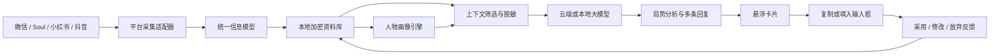

# 情感大师 Android 设计规格

## 1. 项目目标

“情感大师”是运行在 Android 设备上的个人自用辅助工具。它从用户主动打开或明确标记的社交场景中采集聊天、个人资料和社交动态，在本地建立带证据的人物画像，并结合当前关系阶段生成多条不同推进程度的建议回复。

产品不自动发送消息。用户始终负责选择、修改、复制或放弃建议。

### 1.1 已确认约束

- 主要用于个人设备，不面向应用商店公开发布。
- 目标设备可能具有 Root、Magisk、Zygisk 或 LSPosed 能力，但 Root 不是运行前提。
- 模型采用混合模式：本地采集、脱敏、存储和检索；云端模型负责主要推理，也允许未来切换本地模型。
- 采集采用混合策略：默认按需触发，只有用户明确标记的人物才持续建档。
- 平台适配顺序：微信、Soul、小红书、抖音。
- 平台深度适配失效时必须安全降级，不能导致主应用不可用。

## 2. 能力分级与无 Root 支持

主应用启动时检测设备能力，并展示当前工作模式：

| 能力 | 无 Root | 有 Root | 说明 |
|---|---:|---:|---|
| 手动输入或粘贴 | 支持 | 支持 | 最稳定的兜底输入 |
| Accessibility 窗口节点采集 | 支持 | 支持 | 读取当前可访问窗口中的结构化文本 |
| MediaProjection 截图与 OCR | 支持 | 支持 | 节点缺失、Canvas 或自绘界面的兜底 |
| 当前会话按需分析 | 支持 | 支持 | 无 Root 版本的核心功能 |
| 已采集内容的持续人物建档 | 支持 | 支持 | 每次主动采集后增量更新人物档案 |
| 应用私有数据读取 | 不支持 | 视应用而定 | Root 也不保证应用层加密数据可直接读取 |
| LSPosed/Zygisk 运行时采集 | 不支持 | 视设备与应用版本而定 | 用于获取已经解密并准备显示的数据 |
| 后台完整历史同步 | 有限 | 视适配器而定 | 无 Root 时只能积累用户实际打开或导入的内容 |

无 Root 时，系统以 Accessibility 为第一采集层，以截图 OCR 为第二采集层。无障碍节点可能缺失、过期或不包含自绘内容，因此任何低置信度结果都必须经过人工确认，不能静默进入人物画像。

Root 是增强能力，不是硬依赖。Root 模块缺失、未授权或失效时，主应用必须继续提供完整的按需分析和建议回复功能。

## 3. 总体架构

系统由 Android 主应用和可选 Root 扩展组成。

- Android 主应用：悬浮入口、人物档案、分析结果、多回复建议、模型配置、本地数据管理。
- Root 扩展模块：私有数据探测、LSPosed/Zygisk 运行时采集以及与主应用的受控通信。



### 3.1 组件边界

- 采集层只负责获取事实和原始证据，不负责判断人物性格。
- 平台适配器将应用特有内容转换为统一信息模型。
- 人物画像引擎从证据中形成可更新的假设，不输出不可追溯的结论。
- 上下文构建器在本地完成检索、裁剪、摘要和脱敏。
- 模型网关负责调用可配置的 OpenAI-compatible 接口，并为未来本地模型保留统一接口。
- 建议引擎负责校验模型结构化输出并转换为用户可操作的回复卡片。

## 4. 平台采集设计

每个平台实现统一的 `PlatformAdapter` 概念接口：

- 识别当前人物：返回平台、账号标识、昵称及当前会话。
- 采集当前页面：返回聊天消息、个人资料、动态或互动事件。
- 同步已标记人物：按同步游标增量更新，并返回采集完整度。
- 能力探测：报告当前应用版本支持的 Accessibility、OCR、Root 和运行时采集能力。

### 4.1 采集降级顺序

1. Root/LSPosed 深度适配器（存在且兼容时）。
2. Accessibility 结构化节点。
3. MediaProjection 截图与 OCR。
4. 手动粘贴、截图导入或人工校正。

每条采集结果必须记录来源平台、采集方式、采集时间、适配器版本、原始置信度和人工校正状态。

### 4.2 微信首期流程

1. 用户进入聊天窗口并点击悬浮球“分析当前对话”。
2. 系统识别当前人物和可见消息范围。
3. 优先读取 Accessibility 节点，提取发送者、消息方向、文字和时间。
4. 节点缺失或内容为自绘界面时，截图并 OCR。
5. 用户可以进入联系人资料或朋友圈，点击“补充人物资料”。
6. 标记“持续关注”后，每次打开相关页面或执行深度同步时增量更新。
7. Root 环境中，适配器根据探测结果选择本地数据读取或运行时采集；不假设数据库一定可直接解密。

第一版处理文字消息和图片中的文字。语音转写、视频理解和复杂表情语义不进入第一版范围。

### 4.3 后续平台

- Soul：私聊、主页、瞬间及陌生人社交互动。
- 小红书：主页、笔记、评论和可观察的兴趣信号。
- 抖音：主页、作品、公开互动和私信。

各平台共享统一采集与证据接口，只在平台包中维护界面识别规则和深度适配逻辑。

## 5. 统一信息模型

核心实体如下：

- `PersonIdentity`：人物及跨平台身份映射。
- `Message`：消息正文、方向、发送者、时间和来源。
- `SocialPost`：动态正文、发布时间及媒体摘要。
- `Interaction`：点赞、评论、主动发起、回复间隔等互动事实。
- `Evidence`：原始证据、采集方式、置信度和校正状态。
- `ProfileHypothesis`：人物画像假设、支持证据、反向证据和更新时间。
- `RelationshipState`：当前关系阶段及其证据。
- `SuggestionFeedback`：建议的采用、修改、放弃和后续反应。
- `SyncCursor`：平台增量同步位置和适配器版本。

跨平台身份只能由用户确认或合并，不能仅凭昵称和头像自动认定为同一人物。

## 6. 人物画像引擎

人物画像维护一组可更新、可追溯的假设：

- 基础事实：兴趣、职业线索、生活节奏和常聊话题。
- 沟通风格：回复长度、主动程度、幽默偏好和情绪表达方式。
- 关系信号：主动发起比例、回复间隔变化、话题延续和边界表现。
- 可能需求：陪伴、认同、分享、实际帮助或保持距离。
- 禁区与边界：明确拒绝的话题、冲突点和不喜欢的表达。
- 关系阶段：初识、熟悉、暧昧、推进、降温、冲突或修复。

每条画像必须包含：结论、置信度、支持证据、反向证据、最近更新时间和衰减状态。

模型只能表达“更可能”或“现有信息不足”，不能把推测写成事实；不进行医学诊断，也不推断与聊天目标无关的敏感属性。新行为与旧画像冲突时降低旧结论的置信度，而不是强行解释成一致。

## 7. 回复建议引擎

每次分析执行以下步骤：

1. 判断对方消息的表层含义、情绪和可能意图。
2. 结合关系阶段、人物画像和近期对话形成局势摘要。
3. 按用户选择的目标生成四至六条不同推进程度的建议。
4. 对每条建议输出策略意图、推进强度、风险和对方可能的下一步反应。
5. 通过 JSON Schema 校验后展示；不合格输出不能进入有效记录。

建议类型包括：

- 稳妥回应：自然接住，不明显推进。
- 轻度推进：延续话题并增加互动。
- 情绪共鸣：表达理解并拉近距离。
- 幽默调侃：在适合的关系和语境中制造轻松感。
- 明确推进：邀约、表达兴趣或确认关系。
- 边界回应：处理冷淡、冒犯或不合理要求。

默认不提供欺骗、施压、PUA 或利用对方脆弱点的方案。反馈学习聚焦用户自己的语言风格和选择偏好，不把一次成功固化为操控他人的公式。

## 8. 日常交互闭环

1. 用户在目标应用中点击悬浮球。
2. 系统展示识别人物、消息范围、采集方式和完整度。
3. 用户选择目标：延续话题、拉近关系、试探态度、提出邀约、化解冲突或设立边界。
4. 本地组装相关上下文并展示云端发送预览。
5. 模型返回局势判断和多条回复建议。
6. 用户复制、编辑或放弃建议。
7. 用户可以记录对方后续反应，以更新画像和个人表达偏好。

第一版不自动发送消息，只支持复制。后续可以增加“用户确认后填入输入框”，但仍不得绕过最终确认。

## 9. 本地工程结构

```text
情感大师/
├─ README.md
├─ docs/
│  ├─ superpowers/specs/
│  ├─ plans/
│  └─ device-setup.md
├─ android/
│  ├─ app/
│  ├─ core/
│  ├─ capture/
│  └─ root-bridge/
├─ schemas/
├─ prompts/
├─ fixtures/
└─ scripts/
```

Android 初期只建立 `app`、`core`、`capture`、`root-bridge` 四个 Gradle 模块。微信、Soul、小红书和抖音先在 `capture` 内按包隔离；只有出现明确的独立构建或依赖需求时才拆成单独模块。

## 10. 本地数据与模型网关

- 使用结构化数据库保存人物、消息、动态、证据、画像和反馈。
- 数据库密钥由 Android Keystore 保护。
- API Key 不写入源码、普通配置文件或日志。
- 原始截图默认在解析完成后删除；仅在用户开启“保留原始证据”时加密保存。
- 日志只记录适配器状态、错误码和耗时，不记录聊天正文。
- 支持按人物查看、纠正、导出和彻底删除资料。
- 云端请求前展示发送预览，包括摘要、消息范围和脱敏结果。
- 完整聊天和人物资料保存在本地；云端只接收当前请求必要的上下文。

## 11. 错误处理

- Accessibility 未开启：引导用户授权，不尝试静默绕过。
- Root 或 LSPosed 不可用：切换到 Accessibility；必要时继续降级到 OCR。
- OCR 置信度不足：高亮可疑文字，确认前不得写入人物档案。
- 目标应用更新：暂停不兼容的深度适配器，保留通用采集并生成诊断报告。
- 云端超时或限流：保留本次上下文，允许重试或切换模型，不重复写入记录。
- 模型结构错误：自动修复一次；仍失败则展示错误，不保存为有效画像或建议。
- 数据库或解密失败：进入只读保护，不自动清库。
- 任何错误日志不得包含正文、身份信息、API Key 或数据库密钥。

## 12. 测试与验收

### 12.1 测试层级

- 单元测试：统一模型、规范化、证据评分、画像衰减、脱敏、上下文筛选和输出校验。
- 契约测试：所有平台适配器必须通过相同输入输出契约。
- 回归样本：使用脱敏对话、Accessibility 树和截图固定样本。
- Android 仪器测试：权限流程、悬浮窗、截图授权、OCR、数据库和模型调用。
- Root 设备测试：模块启停、授权拒绝、目标应用升级和降级路径。
- 端到端测试：从采集到建议卡片，再到反馈写入的完整闭环。

### 12.2 验收标准

- 脱敏样本能稳定还原消息顺序、发送方向和人物归属。
- 低置信度 OCR 不会静默写入画像。
- 所有模型输出都经过 JSON Schema 校验。
- 飞行模式下仍能查看、纠正、导出和删除本地人物资料。
- 日志扫描不得出现消息正文和密钥。
- 深度适配器故障不会导致主应用崩溃。
- 正常网络下，从触发分析到展示建议的目标时间不超过十秒。
- 每个阶段都有测试结果和真实设备验证记录。

## 13. 分阶段交付

1. 创建基础工程、统一数据模型和本地资料库。
2. 实现手动输入测试对话、云端分析和多回复建议闭环。
3. 实现微信 Accessibility、截图 OCR 和悬浮入口。
4. 实现人物持续建档、证据画像和反馈学习。
5. 实现微信 Root/LSPosed 深度适配和安全降级。
6. 依次接入 Soul、小红书和抖音。

每个阶段必须同时交付源码、测试、构建说明和设备验证记录。未经验证的深度采集能力不得标记为完成。

